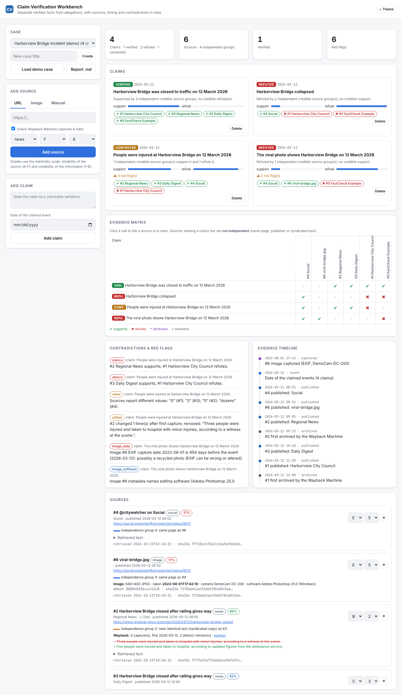

# Open-Source Claim Verification Workbench

**Collect public articles, official statements, archived pages and image metadata, then evaluate claims against them. The workbench builds an evidence timeline, separates verified facts from allegations, and flags contradictions between sources.**



## How it works

1. **Cases** hold **sources** and **claims**. You link sources to claims with a stance (*supports*, *refutes*, *attributes*, meaning it reports someone else saying it, or *mentions*), plus a quote and an optional asserted value such as a number or a date.
2. **Sources** come in three ways:
   * **URL**: the page is fetched and parsed with BeautifulSoup. The tool extracts title, publisher, author and published/modified dates (meta tags, JSON-LD, `<time>`), plus the article text and a SHA-256 of the exact bytes received. It then queries the **Wayback Machine CDX API** for captures: when the page was first archived, how many distinct versions exist and a **sentence-level diff** between the earliest capture and the live page, which catches silent edits.
   * **Image**: EXIF capture time, camera, editing software and GPS are read with Pillow. The tool also stores a perceptual **dHash** so the same picture is recognised across sources, and the SHA-256.
   * **Manual**: phone calls, documents and anything else, recorded with a grade.
3. **Independence.** Sources on the same page, from the same publisher, with near-identical text (5-word shingle containment ≥ 0.6, which catches syndicated copies) or with the same image are grouped. **Corroboration counts groups, not sources**, so ten copies of one wire story are one witness.
4. **Status** for each claim follows explicit rules:
   | Status | Rule |
   |---|---|
   | **verified** | ≥ 2 independent credible groups support it, or a credible primary/official source does, *and* no credible source refutes it |
   | **refuted** | Credible refutation and no credible support |
   | **contested** | Credible sources on both sides |
   | **allegation** | Only low-credibility, uncorroborated or second-hand ("attributes") support |
   | **unverified** | No linked sources |

   "Credible" means an Admiralty grade with confidence ≥ 0.6 (e.g. B2, C2, A3). Change a source's grade and every status updates.
5. **Red flags**: credible sources contradicting each other; different asserted values (numbers or dates); a source **edited after publication** in a way that touches the quoted text; an image whose **EXIF date predates the event**; editing software in the metadata; a source published *before* the event it reports. Each flag carries its caveat ("EXIF can be wrong", "editing is not proof of manipulation").
6. **Evidence timeline**: event dates, publications, first archive captures, detected edits and image capture times on one axis.
7. **Markdown report** with the status per claim, linked statements, red flags, the timeline and a source table with grades, independence groups and hashes.

## Quick start

```bash
git clone https://github.com/Sentinel1569/osint-claim-verifier.git && cd osint-claim-verifier
python -m venv .venv && source .venv/bin/activate
pip install -e ".[dev]"
python -m claimbench serve           # http://127.0.0.1:8000, then "Load demo case"
```

### CLI

```bash
python -m claimbench demo
python -m claimbench case new "Viral flood video"
python -m claimbench source url 1 https://news.example/article --kind news --grade B2
python -m claimbench source image 1 samples/viral-bridge.jpg --grade E5
python -m claimbench claim 1 "The video was filmed in March 2026" --event-date 2026-03-12
python -m claimbench link 1 2 refutes --quote "footage dates from 2019"
python -m claimbench report 1 --markdown > case.md
```

`CLAIMBENCH_DB` selects the database (default `claimbench.db`).

## Demo case

A fictional "Harborview Bridge" incident (all `.example` domains): an official statement, a news article that was **edited from "three" to "five" injured**, a syndicated copy of its original version, a viral social post, a fact-check, and a photo whose EXIF says **August 2023** and names Photoshop. URLs on the reserved `.example` TLD are served from bundled fixtures, so the demo runs offline through the real parsers.

## Responsible use

Use this for verifying public claims. Respect site terms and robots policies, keep fetches modest, and don't use the workbench to compile information about private individuals.

## Tests

```bash
make test && make lint
```

## License

MIT
